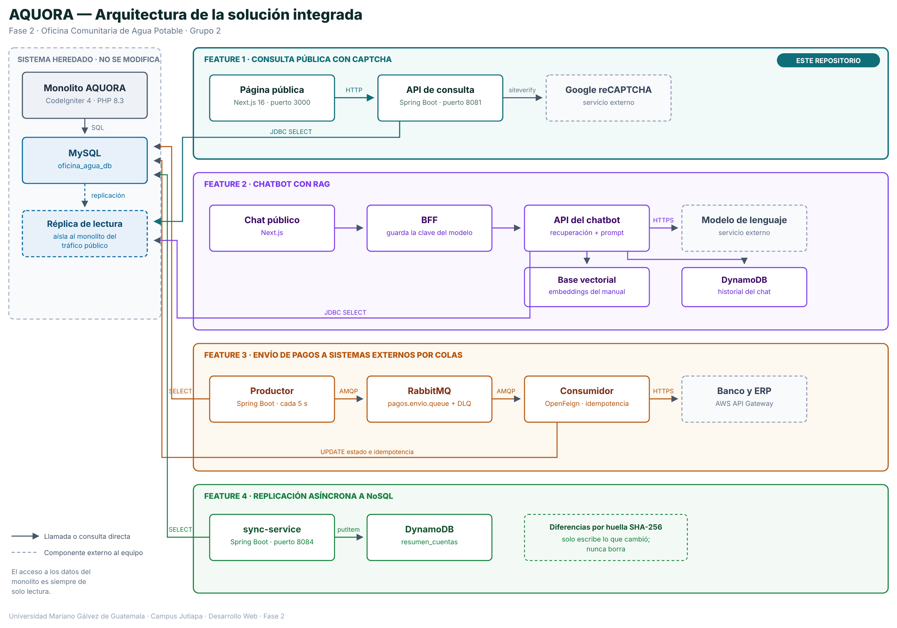

Nombre: Yenci María Hernández Martínez
Carnet: 0905-23-6756
Repositorio: https://github.com/grupo2-stack1-fase2/fase2-feature1-consulta-publica
Modulo asignado: Consulta pública con captcha.

---

# AQUORA — Fase 2 · Consulta Pública con Captcha

Este repositorio contiene mi módulo de la Fase 2: la **consulta pública del
estado de cuenta protegida con captcha**. Incluye el microservicio en Spring
Boot, el frontend en Next.js, la documentación OpenAPI y la documentación de la
arquitectura integrada.

**Alcance del repositorio.** Aquí está implementada la Feature 1 completa. Las
Features 2, 3 y 4 son módulos de otros integrantes del equipo y su código vive
en otros repositorios de la organización; en este documento se explica qué hacen
y cómo se integran, pero no están aquí.

---

## 1. Arquitectura de la solución integrada

La Fase 2 parte del monolito heredado **AQUORA** (CodeIgniter 4 + MySQL) y le
agrega cuatro funcionalidades. La regla que ordena toda la fase es que **el
monolito no se modifica**: los servicios nuevos leen de una réplica de solo
lectura y se comunican por HTTP o por mensajes.

Cada feature vive en su propio repositorio dentro de la organización del grupo:

| Feature | Módulo | Repositorio |
|---|---|---|
| — | Monolito heredado AQUORA | `BryanRiv3ra/oficina-agua-grupo2` |
| 1 | Consulta pública con captcha | `fase2-feature1-consulta-publica` *(este repositorio)* |
| 2 | Chatbot con RAG | `fase2-feature2-chatbot-rag` |
| 3 | Envío de pagos a sistemas externos por colas | `fase2-feature3-pagos-externos` |
| 4 | Replicación asíncrona a NoSQL | `fase2-feature4-replicacion-nosql` |

Este repositorio no modifica el monolito.

### Diagrama



### 1.1 Componentes

| Componente | Tecnología | Responsabilidad | ¿Está en este repo? |
|---|---|---|---|
| Monolito heredado AQUORA | CodeIgniter 4 · PHP 8.3 | Autenticación, clientes, contadores, lecturas, pagos y recibos. Es la fuente de verdad. | No (repo aparte) |
| MySQL | MySQL 8.4 | Base del monolito. Los servicios nuevos solo hacen `SELECT`. | No |
| Réplica de MySQL | MySQL (solo lectura) | Copia de lectura para el tráfico público. Aísla al monolito de las consultas anónimas. | No |
| Página de consulta pública | Next.js 16 · TypeScript | Formulario público, widget de reCAPTCHA y presentación del estado de cuenta. | **Sí** (Feature 1) |
| Servicio de consulta | Spring Boot 4.1 · Java 21 | Valida el captcha contra Google y devuelve el estado de cuenta del contador. | **Sí** (Feature 1) |
| Google reCAPTCHA | reCAPTCHA v2 (casilla) | Servicio externo que emite y verifica los tokens del captcha. | No (servicio externo) |
| BFF del chatbot | Next.js | Intermedia el chat y mantiene la clave del modelo fuera del navegador. | No (Feature 2) |
| Servicio de chatbot | API REST + RAG | Recupera fragmentos del manual, arma el prompt y consulta al modelo. | No (Feature 2) |
| Base vectorial | Vector database | Almacena los *embeddings* de los fragmentos del manual. | No (Feature 2) |
| DynamoDB | DynamoDB | Guarda el historial de prompts y respuestas del chatbot. | No (Feature 2) |
| Productor de pagos | Spring Boot · `@Scheduled` | Revisa cada 5 segundos la tabla `pagos` y publica en la cola los que tienen `estado_envio = 'pendiente'`. | No (Feature 3) |
| RabbitMQ | RabbitMQ · cola `pagos.envio.queue` y DLQ `pagos.envio.dlq` | Desacopla la notificación a sistemas externos de la operación normal del monolito. | No (Feature 3) |
| Consumidor de pagos | Spring Boot · Spring Cloud OpenFeign | Notifica cada pago al banco y al ERP, clasifica la respuesta y controla reintentos e idempotencia. | No (Feature 3) |
| Banco y ERP externos | AWS API Gateway · contratos OpenAPI | Sistemas externos proporcionados por el docente; se consumen con su contrato tal cual. | No (Feature 3) |
| Servicio de replicación (`sync-service`) | Spring Boot 3.5 · Java 17 · AWS SDK v2 | Replica en segundo plano el resumen de cuenta de cada contador. Responde `202` con un `jobId` y procesa en otro hilo. | No (Feature 4) |
| DynamoDB (`resumen_cuentas`) | DynamoDB | Destino NoSQL de la replicación: un documento por contador. | No (Feature 4) |

### 1.2 Conexiones y flujos

| Origen → destino | Protocolo / mecanismo | Para qué |
|---|---|---|
| Monolito → MySQL | SQL | Operación diaria de la oficina |
| MySQL → Réplica | Replicación de MySQL | Mantener la copia de lectura al día |
| Navegador → Página de consulta | HTTP | Formulario público |
| Navegador → Google reCAPTCHA | HTTPS | Obtener el token del captcha |
| Página de consulta → Servicio de consulta | HTTP / JSON, reenviado por el servidor de Next.js | Enviar número de registro y token |
| Servicio de consulta → Google `siteverify` | HTTPS | Verificar que el token es legítimo |
| Servicio de consulta → Réplica MySQL | JDBC `SELECT` | Leer el estado de cuenta |
| Navegador → BFF del chatbot | HTTP / JSON | Chat público; el navegador no ve la clave del modelo |
| Servicio de chatbot → Base vectorial | Consulta de similitud | Recuperar los fragmentos relevantes |
| Servicio de chatbot → DynamoDB | SDK | Guardar prompt y respuesta |
| Productor de pagos → `oficina_agua_db` | JDBC `SELECT` | Detectar pagos pendientes de notificación |
| Productor de pagos → RabbitMQ | AMQP | Publicar el mensaje del pago |
| RabbitMQ → Consumidor de pagos | AMQP | Entregar el mensaje al consumidor |
| Consumidor de pagos → Banco y ERP | HTTPS · OpenAPI · `x-api-key` | Notificar el pago al sistema externo |
| Consumidor de pagos → `oficina_agua_db` | JDBC `UPDATE` | Registrar estado e idempotencia en `envios_banco` |
| Servicio de replicación → `oficina_agua_db` | JDBC `SELECT` con usuario `sync_reader` de solo lectura | Leer el resumen de cuenta de cada contador |
| Servicio de replicación → DynamoDB | AWS SDK · `putItem` | Insertar o actualizar solo los resúmenes cuya huella SHA-256 cambió; nunca borra |

### 1.3 Fronteras y reglas de integración

- **El código del monolito no se toca.** Ninguna feature agrega controladores ni
  modifica su lógica. La única excepción sobre el esquema es la Feature 3, que
  añade tres columnas de control (`estado_envio`, `fecha_envio`,
  `intentos_envio`) a la tabla `pagos` mediante una migración SQL, sin alterar
  el código del sistema heredado.
- **El navegador nunca habla con la base de datos.** Siempre hay una API de por
  medio.
- **Las claves privadas no llegan al navegador**: ni la clave secreta de
  reCAPTCHA en la consulta pública, ni la clave del modelo de lenguaje en el
  chatbot.
- **El acceso a los datos del monolito es siempre de solo lectura.** Las features
  expuestas al público leen de la réplica que establece el diagrama; las
  Features 3 y 4 leen directamente la base del monolito con un usuario
  restringido a `SELECT`, de modo que un fallo en el código no pueda escribir
  sobre los datos de la oficina.
- **Los servicios nuevos no se llaman entre sí.** La consulta pública y el
  chatbot son independientes; lo único que comparten es la réplica.
- **Las operaciones hacia sistemas externos pasan por cola**, para desacoplarlas
  del tiempo de respuesta del usuario.

### 1.4 Cómo se ejecuta la solución integrada

Cada módulo de la Fase 2 vive en su propio repositorio y se levanta por
separado. **Este repositorio no incluye `docker-compose.yml`**: el procedimiento
real de ejecución de la Feature 1 está en la sección 2.4.

---

## 2. Mi módulo: Consulta pública con captcha (Feature 1)

### 2.1 Funcionalidad y objetivo

**El problema.** Para saber si está al día, un vecino tiene que ir hasta la
oficina en horario de atención o llamar. Desde las aldeas eso significa un viaje,
y la mayoría de esas visitas son para preguntar una sola cosa: cuánto debo.

**La solución.** Una página pública donde cualquier persona escribe el número de
registro que aparece en su recibo, resuelve una verificación de seguridad y ve su
estado de cuenta. Sin cuenta, sin contraseña, sin ir a la oficina.

**Qué información se expone.** Únicamente siete campos:

| Campo | Descripción |
|---|---|
| `numeroRegistro` | Identificador del contador |
| `cliente` | Nombre del titular |
| `sector` | Aldea o sector al que pertenece |
| `lecturasRegistradas` | Total de lecturas tomadas |
| `lecturasSinPagar` | Lecturas pendientes de pago |
| `montoPendiente` | Saldo pendiente en quetzales |
| `estado` | "Al día" o "Pendiente" |

Quedan deliberadamente fuera la dirección, el teléfono, el DPI y el historial de
pagos. El criterio fue que alguien que adivine un número de registro no pueda
obtener información sensible de un vecino.

**Por qué lleva captcha.** Sin protección, un script podría recorrer todos los
números de registro y construir un listado completo de los morosos de la
comunidad. El captcha hace inviable ese recorrido a escala.

### 2.2 Integración y responsabilidades

```
Navegador ──HTTP──▶ Servidor Next.js ──HTTP/JSON──▶ API Spring Boot ──▶ Réplica MySQL
    │                  (reenvía /api)                       │
    └──HTTPS──▶ Google reCAPTCHA                            └──HTTPS──▶ Google siteverify
```

| Componente | Cómo se integra | Frontera / decisión |
|---|---|---|
| Monolito AQUORA | No se integra con código; solo se comparte el origen de los datos | No se agrega ningún controlador ni columna al monolito |
| Réplica de MySQL | Lectura con `SELECT` sobre contadores, clientes y lecturas | Solo lectura; el tráfico público no toca la base principal |
| Google reCAPTCHA | El navegador obtiene el token; el servidor lo verifica | La clave secreta vive solo en el servidor |
| Frontend Next.js | Llama a la API por HTTP | Nunca accede a la base de datos |
| Otros módulos | Comparten la réplica | No hay dependencia directa: esta feature no llama al chatbot ni a las colas |

**Sobre el reenvío de `/api`.** El navegador no llama al microservicio por su
dirección y puerto, sino a la misma dirección desde la que cargó la página; el
servidor de Next.js reenvía internamente todo lo que llega a `/api` hacia
`localhost:8081`. Esto se hizo para que la aplicación funcione cuando se expone
por internet: si el navegador apuntara a `localhost:8081`, buscaría ese puerto
en la máquina de quien abre la página, no en la que corre el servicio.

Conviene precisar que **esto no es un BFF**. Un BFF —como el que usa el
chatbot— tiene lógica propia: arma peticiones, mantiene conversación y guarda
claves de API. Este reenvío no hace nada de eso: no transforma la petición, no
guarda estado y no conoce ningún secreto. Es solo un proxy de una línea de
configuración. La consulta pública es una sola petición sin estado y su único
secreto ya vive en el backend, así que una capa con lógica propia no resolvería
ningún problema real.

### 2.3 Decisiones técnicas

**Decisión 1 — El captcha se valida en el servidor, nunca en el navegador.**

| Alternativa | Por qué no se eligió |
|---|---|
| Que el frontend verifique el captcha y solo entonces llame a la API | Todo lo que corre en el navegador está bajo control del usuario. Cualquiera puede abrir las herramientas de desarrollo, ver que la petición va a `/api/consulta` y llamarla directamente. Una validación en el cliente no protege: solo estorba a quien no sabe programar. |
| Confiar en que el endpoint es difícil de adivinar | Seguridad por oscuridad. El endpoint está documentado en Swagger y es visible en la pestaña de red del navegador. |

*Lo que se implementó:* el navegador obtiene un token de Google y lo envía en el
cuerpo de la petición. El backend consulta el endpoint `siteverify` de Google
con su clave secreta y solo continúa si Google confirma que el token es
legítimo. El token es de un solo uso. **Si Google no responde, la consulta se
rechaza**: el sistema falla cerrado, no abierto.

**Decisión 2 — Servicio independiente leyendo de una réplica, en lugar de un
controlador dentro del monolito.**

| Alternativa | Por qué no se eligió |
|---|---|
| Agregar un controlador público al AQUORA existente | Habría sido más rápido, pero expone el sistema del que depende la operación diaria de la oficina a tráfico público anónimo. Un pico de consultas afectaría también a la secretaria registrando pagos. |
| Leer de la base principal desde el microservicio | Mismo problema: el aislamiento del servicio no sirve de nada si ambos golpean la misma base. |

*Lo que se implementó:* un servicio aparte que lee de una réplica de solo
lectura. Si este servicio se cae o se satura, la oficina sigue trabajando. Además
permite desplegarlo y escalarlo sin tocar el sistema heredado.

**Decisión 3 — Se sustituyó un captcha propio por Google reCAPTCHA v2.**

La primera versión usaba un captcha desarrollado desde cero: el servidor generaba
una suma aleatoria, guardaba la respuesta solo del lado del servidor y consumía
el desafío en el primer intento. Era correcto frente a la reutilización de
tokens, pero un bot con reconocimiento de texto resuelve una suma trivial sin
esfuerzo. Se migró a reCAPTCHA v2, que además analiza el comportamiento del
usuario y es mucho más difícil de automatizar.

### 2.4 Cómo probar este módulo

**Requisitos previos**

- Java 21 o superior
- Node.js 20 o superior
- Un par de llaves de Google reCAPTCHA v2, tipo casilla "No soy un robot", con
  `localhost` registrado como dominio

**Paso 1 — Levantar el backend**

La clave secreta no está en el repositorio; se entrega como variable de entorno.

En Windows (PowerShell):

```powershell
cd backend
$env:RECAPTCHA_SECRET="<clave secreta de reCAPTCHA>"
.\mvnw spring-boot:run
```

En Linux o macOS:

```bash
cd backend
export RECAPTCHA_SECRET="<clave secreta de reCAPTCHA>"
./mvnw spring-boot:run
```

El servicio arranca en el puerto **8081**. Se eligió ese puerto porque el 8080
estaba ocupado por el servidor de desarrollo del sistema heredado.

**Paso 2 — Levantar el frontend**

En otra terminal:

```bash
cd frontend
npm install
npm run dev
```

La página queda en **http://localhost:3000**.

**Paso 3 — Flujo de prueba**

Abrir `http://localhost:3000`, escribir un número de registro, marcar la casilla
**"No soy un robot"** y pulsar **"Ver estado de cuenta"**.

| Entrada | Resultado esperado |
|---|---|
| `CT-001` | José Alejandro, Aldea San Matías — **Al día**, Q 0.00 |
| `CT-002` | María Elena Pérez, Los Valle — **Pendiente**, Q 400.00 |
| `CT-003` | Carlos Morales, El Tiucal — **Pendiente**, Q 750.00 |
| `CT-999` | 404 — "No se encontró un contador con ese número de registro." |
| Sin marcar la casilla | La página pide marcarla; no se envía la petición |
| Token inválido o ya usado | 400 — "Verificación de captcha fallida. Intenta de nuevo." |

**Paso 4 — Documentación de la API**

Con el backend en ejecución:

```
http://localhost:8081/swagger-ui.html
```

**Contrato del endpoint**

```
POST /api/consulta
Content-Type: application/json

{
  "numeroRegistro": "CT-001",
  "tokenCaptcha": "<token devuelto por reCAPTCHA>"
}
```

| Código | Significado |
|---|---|
| 200 | Consulta correcta; devuelve los siete campos del estado de cuenta |
| 400 | `{ "mensaje": "Verificación de captcha fallida. Intenta de nuevo." }` |
| 404 | `{ "mensaje": "No se encontró un contador con ese número de registro." }` |

Todos los errores comparten la forma `{ "mensaje": "..." }`, para que el frontend
los maneje de manera uniforme sin importar de qué servicio provengan.

### 2.5 Cómo exponerlo por internet

Para demostrar la funcionalidad desde un dispositivo que no sea la máquina de
desarrollo, se expone el frontend con un túnel de Cloudflare. Con el backend y
el frontend ya levantados, en una tercera terminal:

```bash
cloudflared tunnel --url http://localhost:3000
```

El comando imprime una dirección pública terminada en `.trycloudflare.com`.
Gracias al reenvío de `/api`, basta con exponer el frontend: el microservicio no
necesita su propio túnel.

Tres detalles que hacen falta para que funcione desde afuera:

- El dominio `trycloudflare.com` debe estar autorizado en la consola de Google
  reCAPTCHA, además de `localhost`.
- `CorsConfig` autoriza el patrón `https://*.trycloudflare.com`, porque la
  dirección cambia en cada ejecución del túnel.
- El túnel no es un hospedaje: la máquina de desarrollo sigue siendo el
  servidor, y la dirección deja de funcionar al cerrar las terminales.

---

## 3. Estado actual y pendientes

Para que esta documentación corresponda al código real:

- **Los datos son de prueba, en memoria.** Viven en la clase `ConsultaService` y
  tienen deliberadamente la misma forma que los datos reales de AQUORA. La
  conexión a la réplica de MySQL que describe el diagrama **todavía no está
  implementada**: cuando la réplica exista, solo hay que modificar esa clase.
- **No existe `docker-compose.yml`** en este repositorio. La ejecución es la
  descrita en la sección 2.4.
- **Las llaves de reCAPTCHA están registradas para `localhost`.** Para desplegar
  en un servidor hay que añadir el dominio correspondiente en la consola de
  Google.

---

## 4. Seguridad de la información

- La clave secreta de reCAPTCHA **no está en el repositorio**. Se lee de la
  variable de entorno `RECAPTCHA_SECRET`; si no está definida, la validación
  falla y toda consulta se rechaza.
- La clave de sitio sí aparece en el código del frontend. Es **pública por
  diseño**: el navegador la necesita para dibujar el widget y no sirve para
  validar nada por sí sola.
- No se publican archivos `.env` ni credenciales de base de datos.
- Las llaves utilizadas durante el desarrollo fueron revocadas y regeneradas
  antes de hacer público el repositorio.

Verificación rápida de que no hay secretos versionados:

```bash
git log --all -p -- backend/src/main/resources/application.properties
```

El archivo debe mostrar únicamente la referencia a la variable de entorno.

---

## 5. Estructura del repositorio

```
fase2-feature1-consulta-publica/
├─ README.md
├─ .gitignore
├─ arquitectura.png                 Diagrama de la solución integrada
├─ backend/                         Microservicio Spring Boot
│  ├─ pom.xml
│  ├─ mvnw / mvnw.cmd
│  └─ src/main/
│     ├─ java/gt/edu/umg/consultapublica/
│     │  ├─ ConsultaPublicaApplication.java   Punto de entrada
│     │  ├─ ConsultaController.java           Endpoint POST /api/consulta
│     │  ├─ CaptchaService.java               Verificación del token con Google
│     │  ├─ ConsultaService.java              Datos del estado de cuenta
│     │  └─ CorsConfig.java                   Autorización del origen del frontend
│     └─ resources/
│        └─ application.properties            Puerto y origen de la clave secreta
└─ frontend/                        Aplicación Next.js
   └─ app/
      └─ page.tsx                   Formulario público y presentación del recibo
```

---

## 6. Checklist de entrega

- [x] El README comienza con `Nombre:`, `Carnet:`, `Repositorio:` y `Modulo asignado:`
- [x] El enlace del campo `Repositorio:` es el mismo que se entrega en la plataforma
- [x] Repositorio público
- [x] El código está en la rama principal y es visible al abrir el repositorio
- [x] Módulo documentado: objetivo, integración, decisión técnica y pruebas
- [x] Sin contraseñas, tokens ni archivos `.env` en el repositorio
- [x] Arquitectura de la solución integrada completa, con las cuatro features
- [x] Diagrama guardado en el repositorio y visible dentro del README
- [ ] Enlace abierto en ventana privada para verificar README, diagrama y código
